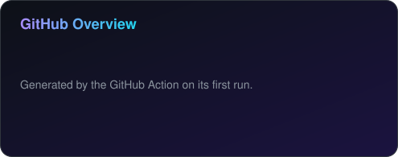
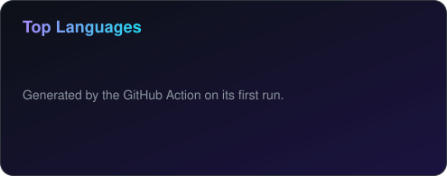

 

  

 

 

## 🧠 About

> I build AI systems that are **grounded, measurable and shippable**: retrieval pipelines that cite their sources, agents that use tools reliably, and deep learning models that make it from a notebook into a deployed product.

I'm a Computer Engineering student at **Cairo University** (class of 2027) working as an **AI engineer**. My focus is Generative AI and LLM applications, from advanced RAG and agentic workflows to training and fine-tuning neural networks in **PyTorch and TensorFlow**. I care about the part that makes AI trustworthy: evaluation, guardrails and honest metrics. I also have solid software engineering foundations (REST backends, microservices, cross-platform mobile apps), so what I build ships as a real product.

<table>
<tr>
<td width="33%" valign="top">

#### 🧠 Generative AI & RAG
Hybrid retrieval, re-ranking, query rewriting, citations, guardrails and multi-provider LLM orchestration.

</td>
<td width="33%" valign="top">

#### 🤖 Agentic AI
Tool-using agents, multi-step workflows, planning and memory, and multi-agent orchestration.

</td>
<td width="33%" valign="top">

#### 🔥 Deep Learning
Training, fine-tuning and deploying models in PyTorch and TensorFlow across audio, vision and NLP.

</td>
</tr>
</table>

- 🌱 **Always learning:** LLM fine-tuning, agent reliability, evaluation at scale, MLOps
- 🤝 **Open to:** AI Engineer, Generative AI and ML roles and internships, and AI project collaborations
- 💬 **Ask me about:** RAG, agents, PyTorch / TensorFlow, evaluation, FastAPI, Spring Boot, Flutter, C++

 

## ⚡ Skills

| | |
|---|---|
| **🧠 Generative AI & LLMs** |   -7c3aed?style=flat-square)          |
| **🤖 Agentic AI** |         |
| **🔥 Deep Learning** |         |
| **🔎 Retrieval & Vector Search** |   -2563eb?style=flat-square) -2563eb?style=flat-square)     |
| **📏 Evaluation & Reliability** |         |
| **📊 Machine Learning & Data** |         |
| **🚀 MLOps & Deployment** |        |
| **💻 Software Engineering** |             |

 

## 🔥 Deep Learning

I train and ship neural networks in both major frameworks, not just call pretrained APIs.

| Framework | What I do with it |
|---|---|
|  | Custom `nn.Module` models and training loops, transfer learning and fine-tuning of pretrained backbones (CNN14 / PANNs), focal loss and weighted sampling for class imbalance, learning-rate scheduling, GPU training, ONNX export for deployment |
|  | Keras Sequential, Functional and subclassed models, `tf.data` input pipelines, callbacks and checkpointing, CNN and GAN architectures, SavedModel and TFLite export |

**Architectures:** CNNs · RNNs / LSTMs · Transformers · GANs · Autoencoders · Transfer learning &nbsp;|&nbsp; **Domains:** audio, computer vision, NLP and Arabic NLP &nbsp;|&nbsp; **Practice:** experiment tracking with MLflow, hyperparameter tuning, error analysis, leakage-free data splits

 

## 💼 Experience

| Period | Role | Where | Highlights |
|---|---|---|---|
| Sep – Oct 2026 | **AI / ML Developer Intern** | EncoderX Tech Internships (Remote) | Built a smart recommendation system and an advanced RAG system (LexSportiva-AI) |
| Jul 2026 | **Backend Intern** | ejada (DCX team) | Backend service development and optimization with Spring Boot |
| Mar – Jun 2026 | **Flutter Mobile Developer Intern** | BetaHubs | Cross-platform SaaS apps, REST API integration, Agile with Jira and Git |
| Oct 2024 – Jun 2025 | **Data Scientist Trainee** | DEPI | End-to-end ML pipelines and predictive models with MLflow. 🏅 Top Achiever (Golden Certificate) |
| Jul – Sep 2024 | **Full Stack Web Developer Trainee** | Faculty of Engineering, Cairo University | React front end and Node / Express back end with MVC architecture |

🏆 **AI Hackathon, Instant & Orange (Aug 2026):** placed in the **top 5 teams** with [ClinicianMind AI](https://github.com/Hazem-Emam-404/ClinicianMind-AI), a guideline-grounded clinical decision support system.

🎓 **Education:** B.Sc. in Computer Engineering, Cairo University (2022 – 2027)

 

## 🤖 AI Projects

<!-- AI-PROJECTS:START -->
> #### ⚖️ [LexSportiva-AI](https://github.com/Hazem-Emam-404/LexSportiva-AI)
> An AI sports referee. A multi-sport RAG assistant that answers rules questions from official rulebooks (IFAB, FIBA, IHF, ITF, IBA) with exact page citations and an in-app PDF viewer. Hybrid retrieval (BGE-M3 + BM25) fused with RRF, parent-child chunking, query rewriting and cross-encoder re-ranking, in English and Arabic.
>
>          

> #### 🩺 [ClinicianMind AI](https://github.com/Hazem-Emam-404/ClinicianMind-AI)
> Evidence-grounded clinical decision support for adult hypertension, built at the Instant & Orange AI Hackathon (top 5 teams). Answers clinician questions from WHO 2021 and NICE NG136 guidelines with chunk-level citations, two-stage retrieval, safety guardrails (emergency and prompt-injection detection, refusal when grounding is weak) and structured JSON output.
>
>         &nbsp; ⭐ **1**

> #### 🔊 [Machine Fault Recognition](https://github.com/Hazem-Emam-404/Machine-Fault-Recognition)
> Deep learning for predictive maintenance: classifies machine sounds into six normal and abnormal states across three machine types. Fine-tunes a pretrained CNN14 (PANNs) on log-Mel spectrograms with focal loss and weighted sampling, reaching 95.84% test accuracy (91.31% baseline). Leakage-free splits, ONNX export, Docker and a Hugging Face demo.
>
>      
<!-- AI-PROJECTS:END -->

<a href="#top">⬆ back to top</a>

 

## 💻 SW Projects

<!-- SW-PROJECTS:START -->
> #### 🛒 [E-Commerce Microservices](https://github.com/Hazem-Emam-404/Ejada-Intern-Project)
> A production-style e-commerce backend built as Spring Boot 3 microservices: Config Server, Eureka, API Gateway, and Auth (JWT), Shop, Inventory and Wallet services. Resilient inter-service calls with OpenFeign and circuit breakers, Outbox pattern for consistency, distributed tracing with Zipkin and Docker Compose.
>
>      

> #### 🏢 [Workspace.eg](https://github.com/Hazem-Emam-404/Workspace.eg)
> A coworking-space app for Egypt that connects freelancers and students with workspace owners. Real-time availability, transparent pricing, verified reviews, map-based discovery and full Arabic (RTL) and English support, built with Clean Architecture.
>
>      

> #### 🚦 [SignGuard](https://github.com/Hazem-Emam-404/sign-road_detection-mobile-app)
> A traffic-sign detection and driver-education app. Detects road signs live from the camera or from gallery images, with an interactive learning section (quizzes and a sign catalog) and spoken feedback in Arabic and English.
>
>      &nbsp; ⭐ **1**

> #### 💬 [Lite X](https://github.com/CUFE-Software-Engineering-Project/Lite_X-mobileApp)
> A cross-platform X (Twitter) client built by a team of students: For You and Following feeds, posts, replies, reposts and bookmarks, profiles, real-time chat over WebSockets, push notifications, search and trends, in English and Arabic.
>
>       &nbsp; ⭐ **1**
<!-- SW-PROJECTS:END -->

<a href="#top">⬆ back to top</a>

 

## 🎓 Faculty Projects

<!-- FACULTY-PROJECTS:START -->
> #### 📉 [Customer Churn Prediction](https://github.com/Hazem-Emam-404/Customer-Churn-Prediction-and-Analysis)
> An end-to-end data science project that identifies customers likely to leave so a business can act early. Covers data exploration, feature engineering, model building and a final MLOps milestone for deployment.
>
>    

> #### 🧳 [TripSync](https://github.com/Hazem-Emam-404/TripSync)
> A tour-management platform for admins, travellers and travel agencies: trip booking, agency profiles and reviews, a rewards points system, travel blogs and an admin dashboard with analytics.
>
>      &nbsp; ⭐ **1**

> #### 👾 [Alien Invasion](https://github.com/Hazem-Emam-404/Alien_Invasion)
> A console war simulation between Earth, Alien and Ally armies, each with its own unit types and abilities. Interactive and silent modes, built on hand-made data structures (linked lists, queues, priority queues and stacks).
>
>   

> #### 🎨 [Paint For Kids](https://github.com/Hazem-Emam-404/PaintForKids)
> A paint-and-play desktop app for children: draw and drag shapes with undo and redo, record and replay sessions, save and load drawings, then switch to play mode for colour and shape matching games.
>
>   

> #### 🧱 [Arkanoid](https://github.com/Hazem-Emam-404/Arkanoid)
> The classic Breakout arcade game written in Assembly: paddle control, ball physics, bricks, scoring, lives and multiple levels with rising difficulty.
>
>  
<!-- FACULTY-PROJECTS:END -->

<a href="#top">⬆ back to top</a>

 

## 📊 GitHub Stats

  
  &nbsp;
  

 

## 📫 Contact

I'm looking for **AI engineering** opportunities and happy to chat about RAG, agents or deep learning.

- 📧 **Email:** [hemam8560@gmail.com](mailto:hemam8560@gmail.com)
- 💼 **LinkedIn:** [Hazem Emam](https://www.linkedin.com/in/hazem-emam-645436272/)
- 🏁 **Codeforces:** [hazememam](https://codeforces.com/profile/hazememam)
- 📍 **Location:** Cairo, Egypt

